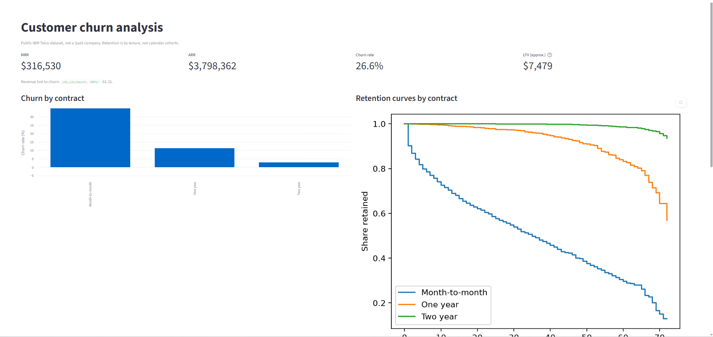
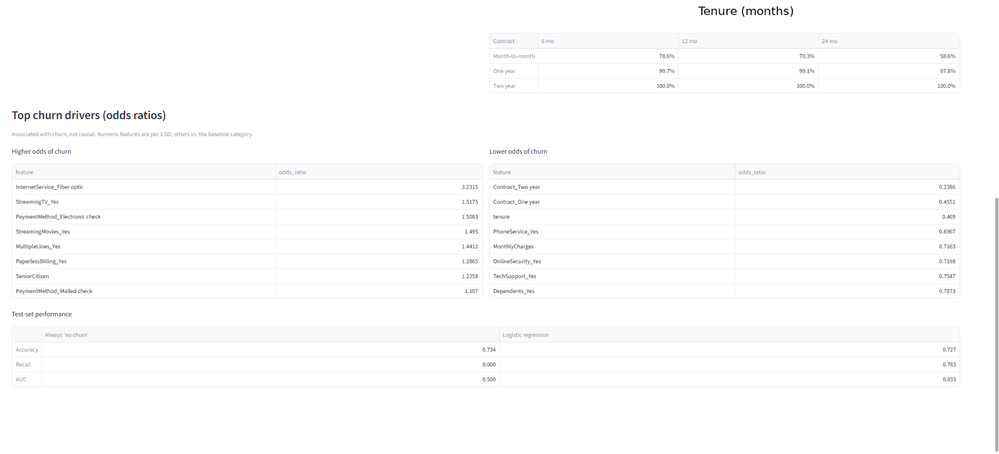

# Customer churn analysis (IBM Telco dataset)

**Question:** Which customers churn, how much revenue does it cost, and what is associated with it?
**Data:** IBM Telco Customer Churn (Kaggle, ~7,000 customers). This is public *telecom* data, not a SaaS company; the metrics (MRR, ARPU, LTV, retention) are defined the same way. No signup dates, so retention is by tenure, not calendar cohorts.

## Setup
```
pip install -r requirements.txt
```
Download the CSV from Kaggle (login required) into `data/` as `WA_Fn-UseC_-Telco-Customer-Churn.csv`.

```
jupyter notebook analysis.ipynb     # run all cells: cleans data and writes churn.db
streamlit run app.py
```

## Method
- Cleaning: dropped 11 rows with `tenure = 0` (blank `TotalCharges`).
- Metrics in `metrics.sql` (SQLite). Churn = customer left (`Churn = 1`). LTV = ARPU ÷ monthly churn, with monthly churn approximated as overall churn ÷ average tenure (rough assumption).
- Kaplan-Meier retention by contract (lifelines).
- Logistic regression (80/20 split, balanced class weights), compared to an always-"no churn" baseline. `TotalCharges` excluded (≈ tenure × MonthlyCharges).

## Findings
Full write-up in [memo.md](memo.md). Key results (7,032 customers):

| Metric | Value |
|---|---|
| Overall churn | 26.6% |
| Churn: month-to-month / one-year / two-year | 42.7% / 11.3% / 2.9% |
| MRR / ARR | $316,530 / $3.80M |
| ARPU | $61.31 |
| Revenue lost to churn | $139,131/month |
| LTV (approximate) | $7,479 |

Retention at 12 months: month-to-month 70.3%, one-year 99.1%.

Model (test set): recall 0.78, AUC 0.83, vs. an always-"no churn" baseline with recall 0 and AUC 0.50. Fiber optic, electronic check and streaming add-ons are associated with higher churn, and longer contracts and tenure with lower churn. These are associations, not causes.




**Limitations:** telecom data, not SaaS. Tenure-based retention only. LTV uses a rough monthly-churn approximation. Two-year retention is flat partly because of contract lock-in.
